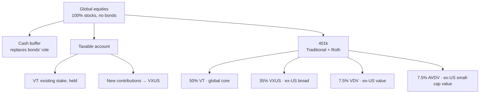
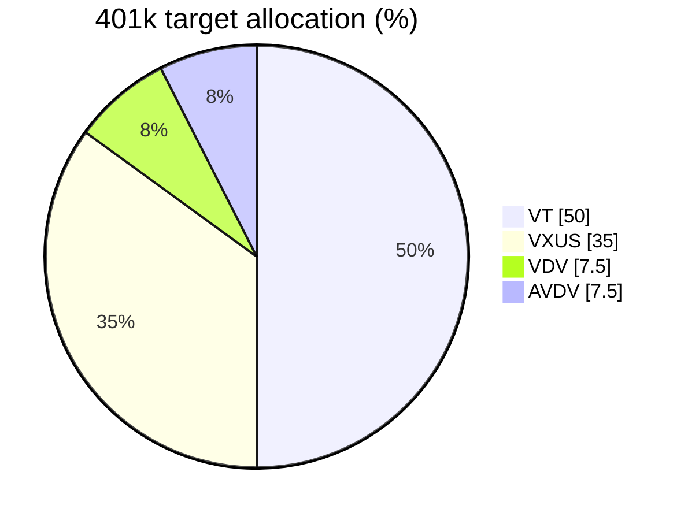
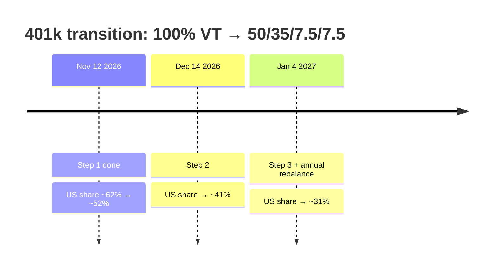
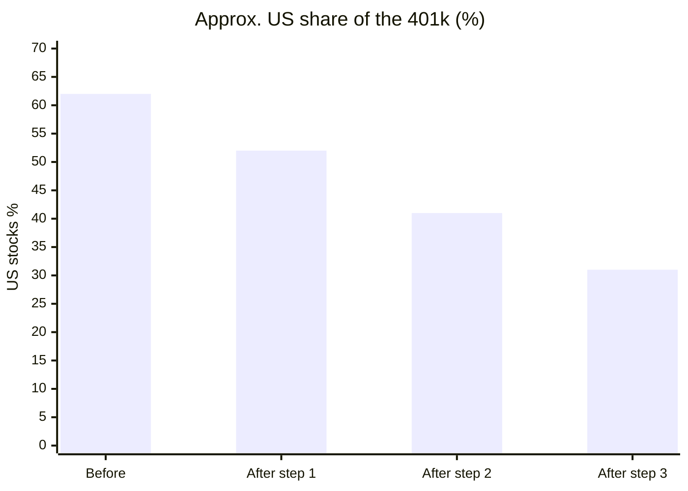
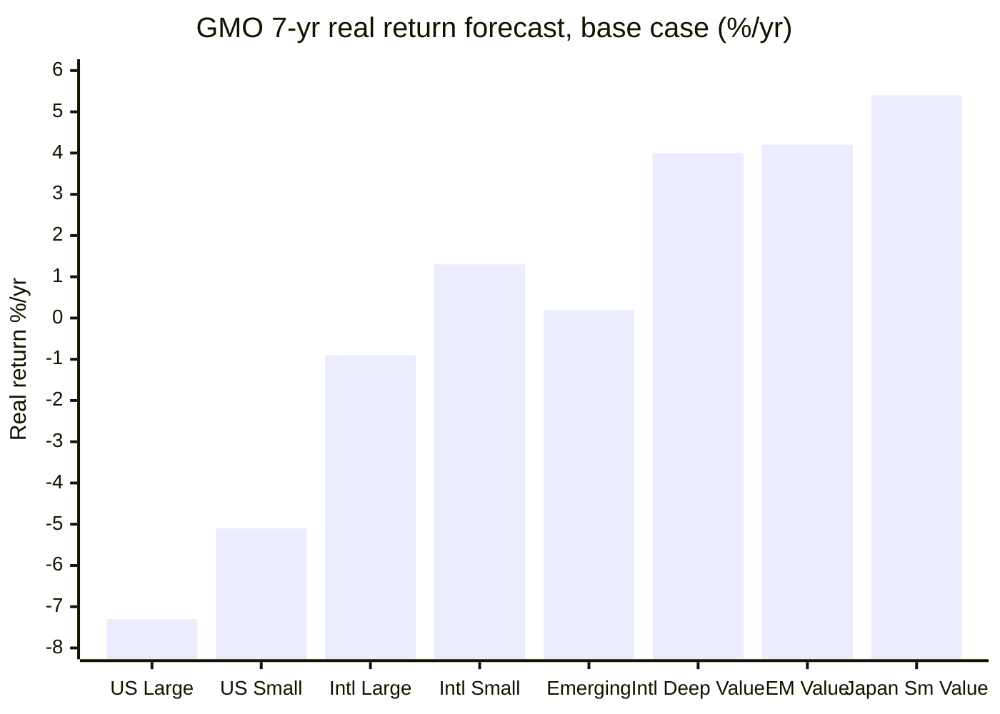
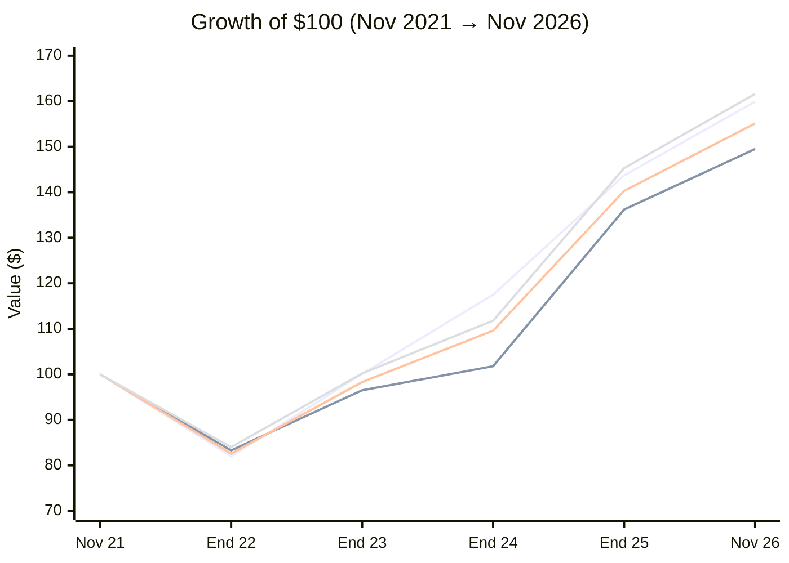
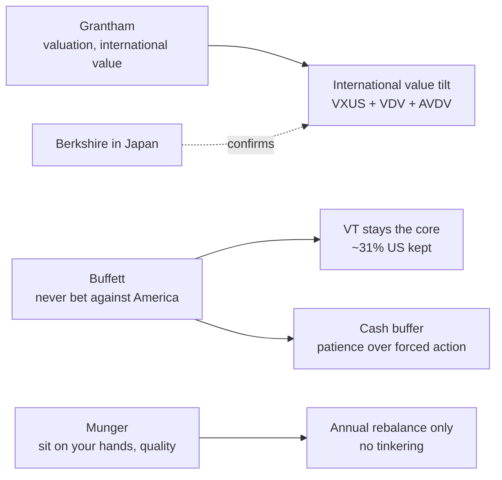

# Investment Philosophy

> [!summary] The short version
> Stay globally diversified and boring, but stop letting market-cap weighting pile ever more of the portfolio into the most expensive market on earth. **VT remains the core.** Around it, the portfolio now tilts **away from US stocks and toward cheap international value**, phased in gradually so that being early (again) is survivable.

## Changelog

- **2026-11-12: international / value tilt.** Prompted by [[#The Grantham thesis|Jeremy Grantham's "Don't own US stocks"]] (Diary of a CEO, June 2026) and GMO's 7-year forecasts. The 401k moves from 100% VT to 50 VT / 35 VXUS / 7.5 VDV / 7.5 AVDV in three steps; taxable new money goes to VXUS. Step 1 executed Nov 12.
	- Dropped the earlier plan of an 80/20 VT/VBR (US small-cap value) split in the taxable account; VBR was never bought. GMO's forecasts favour _international_ value over US value, and the value tilt now lives in the 401k, where it costs nothing in tax.
- **2026-02: VTSAX → VT.** Migrated from the total US market to the total world market. I think this was the post that originally prompted it: [JL goes international and to ETFs, oh my!](https://jlcollinsnh.com/2026/02/08/jl-goes-international-and-to-etfs-oh-my/)

## Core Position

### 401k (Traditional and Roth, same mix in each)

| Fund | What it is | Target | Expense ratio |
|---|---|---|---|
| **VT** | Vanguard Total World: the global core, ~60% US | 50% | ~0.06% |
| **VXUS** | Vanguard Total International: the world minus the US | 35% | 0.05% |
| **VDV** | Vanguard Developed Markets ex-US Value (launched Apr 2026) | 7.5% | 0.08% |
| **AVDV** | Avantis International Small Cap Value | 7.5% | 0.36% |

**Why put the tilt in the 401k:** trades inside it are tax-free in the US and, under the US–Germany treaty, German tax is deferred until withdrawal. That makes it the cheapest place to rebalance. Each account (Traditional and Roth) holds the same mix and is rebalanced on its own.

### Taxable account

- **VT:** existing stake, held. Selling would trigger German capital-gains tax (Abgeltungsteuer), so I don't.
- **New contributions → VXUS** (from Nov 2026). This shifts the mix without selling anything.
- **Two funds, deliberately.** Every extra ETF here is another line on two tax returns, so the value tilt stays in the 401k instead.

## How exposure shifts

The 401k transition is phased: one third now, one third in a month, one third with the January rebalance. If the call is early (Grantham's usual failure mode), I'll have regretted moving everything on one day less.

_US share assumes VT is ~62% US (approximate)._

## The Grantham thesis

Jeremy Grantham (GMO co-founder) told The Diary of a CEO in June 2026 to own no US stocks, calling the AI boom the largest bubble in US history with room for a ~70% fall. His alternative is broad world-ex-US or emerging-market index funds ([IBTimes](https://www.ibtimes.co.uk/jeremy-grantham-us-stock-market-bubble-warning-1805599)). His own family money is mostly in international developed-market value, plus emerging markets ([Barron's](https://www.itiger.com/hans/news/2595725599)).

The engine is GMO's **7-year asset-class forecasts**, which assume valuations and profit margins drift back toward normal. As of Sep 30, 2026, after inflation per year ([GMO](https://www.gmo.com/globalassets/articles/gmo-7-year-asset-class-forecast/2026/gmo-7-year-asset-class-forecastsep26.pdf)):

_I matched the labels to the chart's order myself, so treat this as my reading, not GMO's table._

**Two things that shaped the allocation:**

1. **"International" isn't the whole thesis; "cheap international" is.** In GMO's numbers, broad international (what VXUS holds) is roughly flat after inflation. The +4–5% is in _value_. VXUS gives the "not US" half; VDV and AVDV supply the "cheap" half.
2. **Grantham is reliably early.** He was right about 2000 but two years early, and clients left. He was right in 2009. His own view is that his best timing calls were mostly luck. So the thesis is a _tilt with VT kept as the core_, not a zero-US bet.

## Looking back: the last 5 years

$100 invested Nov 2021, dividends reinvested, rebalanced each January (weekly price data; EFV stands in for VDV, which only launched in 2026):

| Lines (top chart order) | End value | Per year | Volatility | Worst drop |
|---|---|---|---|---|
| 1 · 100% VT | $159.9 | 9.9% | 15.6% | −25.7% |
| 2 · 100% VXUS | $149.5 | 8.4% | 15.8% | −27.7% |
| 3 · 50/50 VT/VXUS | $155.1 | 9.2% | 15.4% | −26.7% |
| 4 · **New 401k mix** (50/35/7.5/7.5) | **$161.6** | **10.1%** | **15.3%** | −25.9% |

**Each fund on its own** (5-year return per year): VDV stand-in 14.3% · AVDV 14.1% · VT 9.9% · VXUS 8.4%.

| Calendar year | VT | VXUS | VDV (EFV) | AVDV |
|---|---|---|---|---|
| 2022 | −18.0% | −16.1% | −5.1% | −11.5% |
| 2023 | +22.0% | +15.9% | +18.8% | +16.9% |
| 2024 | +17.5% | +5.5% | +3.8% | +9.2% |
| 2025 | +22.3% | +33.8% | +43.5% | +50.0% |

### Why the mix works

- **The value funds outperformed.** Both returned about 14% a year against VT's 9.9%, and AVDV gained 50% in 2025. Only 15% of the portfolio in value was enough to more than make up for VXUS lagging VT.
- **Value cushioned the 2022 drop.** The VDV stand-in fell only 5% and AVDV 11.5%, while VT fell 18%. Value behaves differently from VT, whereas VXUS mostly moves with it (92% correlation).
- **2024 was the cost of being early.** US mega-caps ran and VXUS lagged VT by 12 points that year. VXUS alone isn't a hedge; its case is cheaper starting prices, not a softer fall.
- **It's the only mix that doesn't lose either way.** In the backtest it beat 100% VT, 100% VXUS and 50/50, with the lowest volatility. In the [[#Looking forward the next 5 years|forward scenarios]] it comes out ahead in all three: about 15% above 100% VT if GMO is right, level with VT if the last 5 years repeat. That's what a hedge should do.

## Looking forward: the next 5 years

Per $100 today, three scenarios. GMO's after-inflation forecasts are converted to dollar returns with an assumed 2.5% inflation; "last 5 years repeat" replays each fund's own history.

```mermaid
xychart-beta
    title "Projected value of $100 in 5 years"
    x-axis ["GMO base", "GMO low-rate", "Last 5 yrs repeat"]
    y-axis "Value ($)" 0 --> 170
    bar [90.4, 103.5, 160.1]
    bar [100.7, 113.5, 155.0]
    bar [103.5, 116.0, 161.7]
```

| Bars (left → right in each group) | GMO base | GMO low-rate | Last 5 yrs repeat |
|---|---|---|---|
| 100% VT | $90 | $104 | $160 |
| 50/50 VT/VXUS | $101 | $114 | $155 |
| **New 401k mix** | **$104** | **$116** | **$162** |

**Why this allocation and not something bolder:** it's the only option that **doesn't lose in any scenario**. If GMO is right, it beats 100% VT by about 15%. If the last 5 years repeat, it matches VT. A 50/50 VT/VXUS split does better than VT only if GMO is right. Going to zero US would gain more if GMO is right and lose more if not.

_Caveat:_ GMO's US forecasts have been too bearish for most of the last 15 years. These are projections from assumptions, not predictions.

## Other opinions considered

Grantham is one voice. Before committing, I checked the tilt against the two investors whose temperament I trust most: Warren Buffett and Charlie Munger. All three look at the same expensive US market. They disagree about what to do with that information.

### Comparison with Buffett & Munger

| | Grantham | Buffett | Munger |
|---|---|---|---|
| **Unit of analysis** | Asset classes and regions (GMO's 7-year forecasts) | Individual businesses he understands | A handful of excellent businesses |
| **Valuation** | Cheapness, deep value | Price matters; never overpay | Quality first: "a wonderful company at a fair price" |
| **Macro and timing** | Calls bubbles and reallocates | Won't predict; cash builds up when nothing is cheap | Dismissed macro forecasting entirely |
| **The US** | "Don't own US stocks" | "Never bet against America" | Went abroad when it was cheaper (China) |
| **Diversification** | Broad, by asset class | Concentrated for himself; S&P 500 index fund for everyone else | Extreme concentration |
| **Crypto** | "Unnecessary nonsense" | Dismissive | "Rat poison" |

**Where they agreed historically.** Both Grantham and Buffett called the late-1990s tech bubble and looked wrong for about two years before 2000 proved them right. Both turned buyers near the 2008–09 bottom: Buffett with "Buy American. I Am." (October 2008) and Grantham with "Reinvesting When Terrified" (March 2009). Munger said the 2021 market was crazier than the dot-com era, the same call as Grantham's superbubble warnings. _(From memory, not freshly sourced.)_

**Where things stand in 2026:**
- **Buffett is just as worried about valuations.** He's chairman now; Greg Abel became CEO in January 2026. Buffett has said investors have never been in a more "gambling mood". Berkshire sold more stock than it bought for 14 straight quarters and held a record ~$397B in cash in Q1 2026 ([WebProNews](https://www.webpronews.com/berkshires-400-billion-cash-fortress-signals-buffetts-enduring-market-skepticism)).
- **Berkshire's biggest new conviction is international value, which is Grantham's playbook.** It owns over 10% of each of Japan's five big trading houses, and Abel called them comparable in importance to Berkshire's major US holdings ([Jiji/Adnkronos](https://english.adnkronos.com/2026/03/01/berkshire-stakes-in-3-japanese-trading-houses-exceed-10-pct/)).
- **But Berkshire is buying again, including AI.** Under Abel it became a net buyer in Q2 2026 ([Motley Fool](https://www.webull.com/news/15430522333668352)), including large Alphabet purchases ([Motley Fool](https://www.fool.com/investing/2026/06/08/warren-buffett-2026-pullback-wasnt-big-berkshire/)). That's the opposite of Grantham's "sell US tech".
- **Munger died in November 2023**, so there's no 2026 view. His late bets, BYD and Alibaba, were the same instinct as Grantham's: own the cheap market, not the familiar one.

**An overlap worth noting:** Grantham's fallback, "if you must own US stocks, own quality", is pure Munger. They disagree about _when_ quality is worth paying for, not _whether_ it matters.

### What I took from each

- **From Grantham:** the direction of the tilt and the reason for it: international value is where the cheapness is.
- **From Buffett:** don't go to zero US. VT stays the core, so the portfolio still holds roughly 30% US.
- **From Munger:** leave it alone. One rebalance a year, no reacting to headlines. Also his likely criticism: a 7.5% slice here and a 7.5% slice there can be false precision, so either own the value thesis meaningfully or don't own it. _That one is still open; see [[questions#Money & Investing|Questions]]._

_My speculation about how each would react to this portfolio:_ Buffett would call the tilt unnecessary but approve of the discipline about price. Grantham would say 31% US is still too much. Munger would ask why the value slice is so small if I believe in it.

## Principles

1. **Don't panic sell.** Cash reserves exist to weather storms. Equities don't get touched during drawdowns.
2. **Minimize holdings count where it costs something.** Every ETF in the _taxable_ account is another line on the US and German tax returns. Inside the 401k, holdings are free of that cost, which is why the multi-fund tilt lives there.
3. **Shift with new money, not sales, in taxable accounts.** Changing the mix by directing contributions avoids realizing gains (and the German tax that comes with them).
4. **Factor tilts over stock picking.** Value and small-cap value are evidence-based bets on compensated risk, not speculation on companies.
5. **Phase in big changes.** Three steps over two months, not one day. It limits regret if the timing is wrong.
6. **Rebalance once a year, with bands.** Every January; skip any fund within ±2 points of target.
7. **Simplicity is a feature.** Complexity is the enemy of follow-through. Every fund has to earn its place.

## Tax Considerations (US Expat in Germany)

The dual-tax situation creates a fundamental tension:

| | US Tax | German Tax |
|---|---|---|
| **US-domiciled ETFs (VT, VXUS)** | Clean | Punitive (opaque fund treatment under InvStG 2018) |
| **UCITS ETFs (e.g., VWCE)** | Punitive (PFIC reporting) | Favorable (30% Teilfreistellung on equity ETFs) |

Current approach: hold US-domiciled ETFs in the taxable account, using MiFID II professional client status to access them from the EU. Accept the German opaque-fund treatment as the lesser evil compared to PFIC reporting on the US side.

**401k:** treaty-deferred in Germany until withdrawal, so trading inside it creates no German taxable event. **Open question for the Steuerberater:** does Germany honour the Roth's tax-free withdrawals? If yes, consider _asset location_: put the highest-expected-return value funds in the Roth, with VT and VXUS in the Traditional account.

This should be revisited with a qualified cross-border tax advisor now that German tax residency is established.

## What This Portfolio Is Not

- **Not a bond portfolio.** 100% equities, by design. The cash buffer serves the volatility-dampening role.
- **Not a stock-picking portfolio.** No individual equities. Factor exposure through index funds only.
- **Not a market-timing bet.** The tilt is a valuation-based allocation held for years and phased in, not a call on when the drop comes.
- **Not optimized for either tax jurisdiction.** It's optimized for the intersection of both, which means accepting suboptimal treatment somewhere.
- **Not static.** Revisit if valuations normalize (e.g., GMO's US forecasts turn positive) or the tax picture changes.

## "Don't just do something, stand there"

_Added by Claude, 2026-09-25 (`source/ai/claude`), from a Readwise task on JL Collins._

> [!quote] JL Collins, ["The One Thing That Will Determine Whether the Market Makes You Wealthy or Leaves You Bleeding on the Side of the Road"](https://jlcollinsnh.com/2025/05/12/the-one-thing-that-will-determine-whether-the-market-makes-you-wealthy-or-leaves-you-bleeding-on-the-side-of-the-road/) (12 May 2025)
> As Jack Bogle once famously said: "Don't just do something, stand there."

**Bogle's own words** (AARP interview, 2017): _"You've heard the phrase 'Don't just stand there, do something'? For investors, by far the better advice is 'Don't do something, just stand there.'"_ ([AARP](https://www.aarp.org/money/retirement/financial-advice-jack-bogle/)). **The inversion is older than Bogle:** Quote Investigator traces it to a 1945 Leonard Lyons column crediting the actor-producer Martin Gabel, and it's the White Rabbit's line in Disney's _Alice in Wonderland_ (1951) ([Quote Investigator](https://quoteinvestigator.com/2014/03/22/stand-there/)). So: Bogle's use, not Bogle's coinage.

Collins's point around it: corrections and crashes are normal; **your behaviour during the drop, not the drop, decides the outcome**; nobody times the market (he quotes Bogle again: _"I don't even know anybody who knows anybody who has done it successfully and consistently"_). It's Principle 1 above ("Don't panic sell") in six words.

**Beyond investing, in your words:** _"It also applies to the general stance I take on many personal decisions. For example, whether to purchase a new house."_

**And it's the tension in this update:** a tilt _is_ doing something. The guardrails (VT stays the core, phase in, annual bands, no taxable selling) are what keep it a considered allocation change and not market timing in disguise.

---

_Not financial advice. Data: exchange price history, Vanguard and GMO publications. Updated with Claude, 2026-11-12 ([session](https://claude.ai/code/session_01RCTYJ7LqMpax1P8WRfcqjB))._
